# Spatiradix, COSMIC e VEIL Ω
## Documentação técnica

> Este documento reúne descrições e propostas de projeto. Para distinguir o
> que foi testado do que ainda falta validar, consulte [Validação](VALIDACAO.md).

> **Versão do Sistema**: 0.1.0-alpha  
> **Linguagem Base**: Rust (Edição 2021)  
> **Arquitetura**: Monorepo Descentralizado, Pós-Quântico, Orientado a Fisiologia Biológica  
> **Crates Documentados**: 30 crates e plataformas  
> **Data de Homologação**: 2026-09-24  

---

## Sumário

1. [Visão Geral & Filosofia Biológica](#1-visão-geral--filosofia-biológica)
2. [Arquitetura Sistêmica em Camadas (L0 a L4)](#2-arquitetura-sistêmica-em-camadas-l0-a-l4)
3. [Protocolo VEIL Ω — Onion Routing Pós-Quântico](#3-protocolo-veil-ω--onion-routing-pós-quântico)
4. [Ecossistema COSMIC — Computação Soberana & QEL Sharding](#4-ecossistema-cosmic--computação-soberana--qel-sharding)
5. [Sclerotium & Ghost Carrier — Dormência Biológica & Despertar Físico](#5-sclerotium--ghost-carrier--dormência-biológica--despertar-físico)
6. [Dicionário Exaustivo de Crates do Monorepo](#6-dicionário-exaustivo-de-crates-do-monorepo)
7. [Fronteira e Aplicações: Event Horizon, Vitrine & Streaming](#7-fronteira-e-aplicações-event-horizon-vitrine--streaming)
8. [Manual Operacional da CLI & Deployment](#8-manual-operacional-da-cli--deployment)

---

## 1. Visão Geral & Filosofia Biológica

O Spatiradix é um projeto de comunicação, computação e armazenamento
distribuídos. Seu desenho considera redes com conectividade limitada e outras
condições adversas; a capacidade de operar nelas depende de testes específicos.

### A Metáfora Fúngica
Os nomes de vários componentes vêm do micélio e de outras estruturas dos fungos:

```
    [ Árvore / Cliente ]           [ Árvore / Cliente ]
            │                              │
    ┌───────▼──────────────────────────────▼───────┐
    │              REDE MICELIAL                   │
    │  (Hifas, Rizomorfos, Esporos e Nutrientes)   │
    └───────┬──────────────────────────────┬───────┘
            │                              │
    [ Nó / Esporocarpo ]           [ Nó / Sclerotium ]
      (Relay Público)                (Nó Dormente)
```

1. **Hifas (*Hyphae*)**: Conexões ponto-a-ponto ativas (QUIC, TCP, Noise, WebRTC, Nostr).
2. **Rizomorfos (*Rhizomorphs*)**: Feixes de alta capacidade que canalizam grandes volumes de tráfego entre clusters.
3. **Esporos (*Spores*)**: Fragmentos de dados imutáveis endereçados por conteúdo (BLAKE3 Content-Addressing).
4. **Nutrientes (*Nutrients*)**: O sangue econômico da rede (`ATP`, `Enzymes`, `Mycelia`, `Spores`, `Resilience`), recompensando nós que cooperam no transporte e armazenamento.
5. **Esporocarpo (*Sporocarp*)**: Nós com IP público ou servidores de borda que atuam como relays, sementes de bootstrap e pontos de presença CDN.
6. **Escleródio (*Sclerotium*)**: Estrutura dormente que preserva a identidade de nós desligados ou suspensos sem consumir energia de CPU.

---

## 2. Arquitetura Sistêmica em Camadas (L0 a L4)

A arquitetura do Mycelium organiza-se em 5 camadas complementares e intercambiáveis:

```mermaid
flowchart TD
    subgraph L4 ["L4 - Aplicações & Fronteira"]
        Singularity["Singularity (Event Horizon :7474)"]
        Media["Mycelium Media (HLS Streaming)"]
        Vitrine["Vitrine da Floresta / Console Web"]
        Store["Mycelium Store & Chambers"]
    end

    subgraph L3 ["L3 - Computação, Armazenamento & Metabolismo"]
        Cosmic["COSMIC Compute (VOID-00 ML-DSA-87)"]
        QEL["QEL Sharding K/N (Cauchy/RS)"]
        SporeBank["SporeBank (Armazenamento de Blocos BLAKE3)"]
        Nutrients["Nutrient Ledger (ATP, Enzimas, Esporos)"]
        Plasma["Plasma Sandbox (WASM & Processos)"]
    end

    subgraph L2 ["L2 - Anonimato, Ofuscação & Criptografia"]
        VeilLive["VEIL Ω LIVE (3-Hop Onion Routing)"]
        VeilMix["VEIL Ω MIX (Poisson Delay Mixnet)"]
        PQC["Criptografia Pós-Quântica (ML-KEM-1024, ML-DSA-87)"]
        ZKP["ZKP (Pedersen Commitments, Hashcash SHA-3)"]
        DistanceBridge["DistanceBridge (Multi-Canal & Evasão)"]
    end

    subgraph L1 ["L1 - Transporte & Malha Viva"]
        Hyphae["mycelium-hyphae (libp2p, QUIC, TCP, Noise)"]
        Kademlia["Kademlia DHT & Gossipsub v1.2"]
        NostrTrans["Nostr Transport (WSS Fallback)"]
        DTN["DTN Mailbox (Store-and-Forward)"]
    end

    subgraph L0 ["L0 - Substrato Físico, Identidade & Hardware"]
        Sclerotium["Sclerotium (Dormência Biológica)"]
        GhostCarrier["Ghost Carrier (Sub-GHz / WoL / 802.11ba)"]
        GhostID["GhostID (Identidade Efêmera & MAC Spoofing)"]
        Vacuum["Vacuum (Zero-Trace RAM Sanitizer)"]
        Entropy["Entropy (CSPRNG & Coleta de Ruído)"]
    end

    L4 --> L3
    L3 --> L2
    L2 --> L1
    L1 --> L0
```



---

## 3. Protocolo VEIL Ω — Onion Routing Pós-Quântico

O **VEIL Ω** é uma proposta de roteamento com privacidade sobre o Mycelium.
O modelo considera criptografia pós-quântica e análise de tráfego; ele não
comprova anonimato contra observadores globais. Consulte o
[modelo de ameaças](veil/THREAT_MODEL.md) e os testes WAN pendentes.

### 3.1. Criptografia em Camadas ML-KEM-1024 + AEAD ChaCha20-Poly1305
O circuito de 3 saltos (*Entry Guard* $\to$ *Relay* $\to$ *Exit*) encapsula cada pacote em 3 camadas concêntricas:

$$\text{Packet} = \mathcal{E}_{K_{\text{guard}}}(\mathcal{E}_{K_{\text{relay}}}(\mathcal{E}_{K_{\text{exit}}}(\text{Payload})))$$

- **Troca de Chaves**: Baseada em **ML-KEM-1024** (FIPS 203), com derivação de chave de sessão via HKDF-SHA256 e BLAKE3.
- **Cifragem de Fluxo**: **ChaCha20-Poly1305** com verificação de integridade a cada salto. Nenhum nó intermediário conhece a rota completa:
  - O **Guard** conhece a origem e o Relay, mas não o Exit nem o Payload.
  - O **Relay** conhece o Guard e o Exit, mas não a origem nem o destino final.
  - O **Exit** conhece o Relay e o destino final, mas não sabe quem originou o tráfego.

### 3.2. Os Dois Planos de Operação
1. **Plano LIVE (Baixa Latência)**:
   - Destinado a tráfego interativo (navegação HTTP via SOCKS5, chamadas RPC, streaming de áudio).
   - Otimizado para latências mínimas com multiplexação em streams independentes.
2. **Plano MIX (Alta Ofuscação / Mixnet Estocástica)**:
   - Destinado a mensagens assíncronas, propagação de blocos e transações confidenciais.
   - Aplica atrasos estocásticos modelados por um **Processo de Poisson** ($\lambda = 0.5 \text{ a } 2.0\text{ s}$).
   - Propõe pacotes de cobertura (*chaff traffic*) com tamanho fixo (1280 bytes) para dificultar a correlação de tamanho e tempo; isso não impede toda análise de tráfego.

### 3.3. As 7 Camadas Herdadas e Corrigidas do ET-COSMIC-OLD (GhostVPN)
O VEIL Ω incorpora e corrige as vulnerabilidades do antigo ecossistema ET-COSMIC:
- **Camada 0 — Identidade Efêmera**: `GhostID` rotacionado a cada sessão com MAC local administrado (IEEE 802).
- **Camada 1 — Fragmentação Segura**: O QEL particiona pacotes sem embutir a chave simétrica de sessão nos cabeçalhos.
- **Camada 2 — Transporte Fantasma**: `DistanceBridge` com envio concorrente por múltiplos canais (Ethernet + Wi-Fi + Nostr) e chaveamento anti-DPI.
- **Camada 3 — Consenso Causal e Anti-Replay**: Registro contínuo `HashChronicle` e validação por Cone de Luz relativístico ($|\Delta x| \le c \cdot \Delta t$).
- **Camada 4 — Execução Invisível**: Execução de chamadas dentro da sandbox confinada `plasma`.
- **Camada 5 — Ofuscação Temporal**: *Quantized Rate Control* (QRC) com padding estocástico constante.
- **Camada 6 — Zero-Trace em RAM & ZKP**: Uso do `vacuum` para sobrescrever chaves e compromissos de Pedersen com geradores independentes $G \neq H$.

### 3.4. Proxy SOCKS5 Local e Prevenção Anti-SSRF
- O nó sobe um proxy SOCKS5 local na porta `:9050`.
- **Resolução de DNS**: O desenho prevê enviar nomes pelo túnel para resolução no nó de saída. A ausência de vazamentos precisa ser verificada em cada ambiente e aplicação.
- **Anti-SSRF (Server-Side Request Forgery)**: O nó de saída do VEIL bloqueia qualquer tentativa de conexão direcionada a endereços privados (RFC 1918: `10.0.0.0/8`, `172.16.0.0/12`, `192.168.0.0/16`), loopback (`127.0.0.0/8`), CGNAT (`100.64.0.0/10`) e metadados de provedores de nuvem (`169.254.169.254`).

---

## 4. Ecossistema COSMIC — Computação Soberana & QEL Sharding

O **COSMIC** é a infraestrutura de computação distribuída e armazenamento particionado pós-quântico do Mycelium.

### 4.1. QEL (Quantum Entanglement Layer) Sharding
O particionamento de arquivos no COSMIC não utiliza replicação ingênua de arquivos completos. Em vez disso, aplica um esquema **$K$-de-$N$ de Codificação de Apagamento**:
- Um arquivo é dividido em $N$ fragmentos (*shards*) criptográficos.
- Qualquer subconjunto de $K$ fragmentos ($K < N$) é suficiente para reconstituir o arquivo original de forma exata.
- Menos de $K$ fragmentos fornecem **zero bits de informação** sobre o arquivo original (segurança da teoria da informação).

```text
                  Arquivo Original (ex.: 10 MB)
                               │
                       [ QEL Encoder ]
                     K = 3  |  N = 7
                               │
       ┌──────┬──────┬──────┬──┴───┬──────┬──────┬──────┐
       ▼      ▼      ▼      ▼      ▼      ▼      ▼
    Shard1 Shard2 Shard3 Shard4 Shard5 Shard6 Shard7
    (PeerA) (PeerB) (PeerC) (PeerD) (PeerE) (PeerF) (PeerG)
```

Se quatro das sete partes ficarem indisponíveis, as três restantes podem
reconstruir o arquivo, desde que sejam válidas e acessíveis.

### 4.2. Licenças Criptográficas VOID-00 (ML-DSA-87)
Para contratação e autorização de computação na malha, o COSMIC utiliza certificados **VOID-00**:
- Assinados com **ML-DSA-87** (Dilithium5 - Nível 5 do NIST).
- Define o detentor da licença (`holder_pubkey`), a validade (`valid_until`), o escopo de execução (`scope`) e o limite de consumo de `ATP`.
- ML-DSA foi projetado para resistir aos ataques quânticos conhecidos que afetam algoritmos baseados em fatoração e logaritmo discreto; isso não torna uma implementação infalível.

---

## 5. Sclerotium & Ghost Carrier — Dormência Biológica & Despertar Físico

A solução do Mycelium para o dilema de alta disponibilidade sem consumo de energia 24/7 é o protocolo **Sclerotium**:

```text
               ┌──────────┐
               │   LIVE   │ ◄─────── Acordar via WakeToken
               └────┬─────┘
                    │
                    ▼ Suspensão / Inatividade
               ┌──────────┐
      ┌─────── │ DORMANT  │ ◄─────── Standby / Receptor PHY ativo
      │        └────┬─────┘
      │             │
      │             ▼ Desligamento Total / Sem Sinal
      │        ┌──────────┐
      │        │  GHOST   │ ◄─────── Peers mantêm GhostLease
      │        └────┬─────┘
      │             │
      │             ▼ Expiração da GhostLease
      │        ┌──────────┐
      │        │   DEAD   │
      │        └──────────┘
```

### 5.1. Os Quatro Estados de Vitalidade
1. **`LIVE`**: CPU/RAM ativas, pilha libp2p conectada, provendo rotas, computação e armazenamento.
2. **`DORMANT`**: CPU principal suspensa; placa de rede (NIC) ou microcontrolador auxiliar de baixíssimo consumo (ESP32 / RP2040) monitora o canal de despertar.
3. **`GHOST`**: Nó sem conectividade; peers vizinhos mantêm sua **`GhostLease`** criptográfica assinada, atendendo consultas de localização de conteúdo, recebendo mensagens em mailboxes DTN e emitindo pulsos de despertar sob demanda.
4. **`DEAD`**: Tempo de vida da `GhostLease` expirado sem renovação.

### 5.2. O `WakeToken` Criptográfico Anti-DoS
Para reduzir despertares indevidos por ruído ou pacotes falsos, o desenho usa um `WakeToken` autenticado:

$$\text{WakeToken} = \text{BLAKE3-MAC}(K_{\text{node}}, \text{requester} \parallel \text{epoch} \parallel \text{nonce} \parallel \text{reason})$$

A NIC ou o receptor auxiliar valida a assinatura antes de energizar a placa-mãe via linha PCIe / Wake-on-LAN.

---

## 6. Dicionário Exaustivo de Crates do Monorepo

Esta tabela apresenta uma seleção de crates e plataformas. A lista atual de
membros e dependências está no [Cargo.toml](../Cargo.toml) do workspace e nos
manifestos de cada crate.

| Crate | Diretório | Papel Principal | Dependências Chave |
|---|---|---|---|
| `mycelium-core` | `crates/mycelium-core` | Primitivos do sistema (`NodeId`, `ContentId`, `trait FruitingBody`, `Nutrient`) | `blake3`, `serde`, `thiserror` |
| `mycelium-hyphae` | `crates/mycelium-hyphae` | Transporte, descoberta, gossip e DHT | `libp2p`, `tokio` |
| `mycelium-veil` | `crates/mycelium-veil` | Protocolo VEIL Ω, circuitos onion 3 saltos, SOCKS5, Anti-SSRF, planos LIVE/MIX | `mycelium-pqc`, `chacha20poly1305`, `tokio` |
| `mycelium-sclerotium` | `crates/mycelium-sclerotium` | Fisiologia da dormência, `GhostLease`, `WakeToken`, portadora analógica | `ed25519-dalek`, `blake3`, `tokio` |
| `mycelium-pqc` | `crates/mycelium-pqc` | Encapsulamento de chaves ML-KEM-1024 | `ml-kem` |
| `mycelium-qel` | `crates/mycelium-qel` | Fragmentação Shamir K-de-N | `shamir_share`, `blake3` |
| `mycelium-ghostid` | `crates/mycelium-ghostid` | Identidade efêmera e administração local de endereços MAC | `secp256k1`, `sha2` |
| `mycelium-distancebridge` | `crates/mycelium-distancebridge` | Seleção de transportes por contexto | `mycelium-qel`, `serde` |
| `mycelium-zkp` | `crates/mycelium-zkp` | Provas de conhecimento zero, compromissos de Pedersen e PoW anti-Sybil | `curve25519-dalek`, `sha3` |
| `vacuum` | `crates/vacuum` | Chambers e execução isolada conforme configuração | `libc`, `mycelium-core` |
| `mycelium-pheromones` | `crates/mycelium-pheromones` | Identidade Ed25519, trilhas e sinais | `ed25519-dalek`, `mycelium-core` |
| `mycelium-nutrients` | `crates/mycelium-nutrients` | Ledger bioquímico (`ATP`, Enzimas, Esporos) e liquidação de transferências | `serde`, `ed25519-dalek` |
| `mycelium-sporebank` | `crates/mycelium-sporebank` | Armazenamento de Plots endereçados por conteúdo | `giggs`, `serde_json` |
| `singularity` | `crates/singularity` | Event Horizon e roteamento HTTP | `axum`, `tokio` |
| `mycelium-store` | `crates/mycelium-store` | Gerenciador de câmaras de execução de processos e apps | `tokio`, `serde_json` |
| `mycelium-media` | `crates/mycelium-media` | Fragmentação e distribuição de mídia | `tokio`, `blake3` |
| `mycelium-node` | `crates/mycelium-node` | O organismo completo: une hifas, VEIL, esporos, console web e vitrine | Todas as crates acima |
| `mycelium-cli` | `cli/mycelium-cli` | Linha de comando do operador Mycelium | `clap`, `tokio` |
| `cosmic-cli` | `crates/cosmic-cli` | CLI de computação soberana, sharding QEL e certificados VOID-00 | `clap`, `mycelium-qel` |
| `plasma` | `crates/plasma` | Orquestração de Ions | `vacuum`, `mycelium-core` |
| `thefield` | `crates/thefield` | Signals e quórum por ressonância | `mycelium-core`, `serde` |
| `entropy` | `crates/entropy` | Partilha de segredos Shamir | `rand`, `mycelium-core` |
| `mycelium-nostr` | `crates/mycelium-nostr` | Integração com eventos Nostr e assinaturas Schnorr | `tokio-tungstenite`, `secp256k1` |
| `mycelium-nostr-transport` | `crates/mycelium-nostr-transport` | Transporte P2P invisível envelopado sobre relays Nostr WSS | `tokio-tungstenite` |
| `mycelium-ipfs` | `crates/mycelium-ipfs` | Armazenamento local de blocos | `mycelium-core`, `hex` |
| `mycelium-tropical` | `crates/mycelium-tropical` | Álgebra tropical e seleção de rotas | `serde`, `thiserror` |
| `isotope` | `crates/isotope` | Estado distribuído com CRDT last-writer-wins | `mycelium-core`, `serde` |
| `giggs` | `crates/giggs` | Versionamento de conteúdo em Plots | `mycelium-core`, `serde_json` |
| `inertia` | `crates/inertia` | Execução de Vectors de build, teste e deploy | `mycelium-core`, `serde_json` |
| `cosmoplanck` | `platforms/cosmoplanck` | SDK de integração da plataforma Planck com a malha | `reqwest` |

---

## 7. Fronteira e Aplicações: Event Horizon, Vitrine & Streaming

### 7.1. Event Horizon (`:7474`)
O crate `singularity` expõe o ponto de contato do micélio com a Internet pública:
- Roteamento transparente baseado em gravidade de nós.
- Balanceamento autônomo: nós que acumulam mais nutrientes `ATP` e menor latência absorvem maior fração do tráfego externo.

### 7.2. Vitrine da Floresta Iônica (`/vitrine`)
Interface visual de demonstração das capacidades soberanas da rede:
- **Hospedagem Web Soberana**: Servindo páginas estáticas e SPAs sem intermediários centrais.
- **Git Descentralizado**: Repositórios de código versionados por esporos BLAKE3.
- **Mycelium Video**: Demonstração de streaming P2P com fragmentação HLS e distribuição por esporos.
- **MicroEasy Studio**: Loja e runtime de preservação de jogos retrô e emulação soberana.

### 7.3. TheField (`/field/`) — Forja Soberana de Repositórios Git P2P & Signals
Interface web unificada que substitui o GitHub e forjas centralizadas de código:
- **Catálogo de Repositórios**: Lista todos os repositórios persistentes na `RefStore` e snapshots do `SporeBank`.
- **Explorador de Arquivos & Código**: Navegação por diretórios e visualizador de código fonte com hashes BLAKE3 por folha.
- **Genealogia de Commits (Lineage DAG)**: Rastreamento do histórico completo de Plots a partir do nó raiz.
- **Signals & Ressonância (`thefield`)**: Emissão e votação P2P por quórum (`MergePlot`, `Release`, `Pipeline`) diretamente via `/field/api/signals`.
- **Chamber CI Integrado**: Validação e verificação de integridade automatizada em Vacuum Chambers com sanitização zero-trace de memória.
- **Comandos de Clone Prontos**: Integração com a CLI `mycelium repo clone --cid <CID> --dest <pasta>` e `mycelium field`.

---

## 8. Manual Operacional da CLI & Deployment

### 8.1. Compilação do Workspace
```bash
# Compilar todo o ecossistema com verificações estritas
cargo build --release --workspace

# Executar testes unitários e de integração
cargo test --workspace

# Gerar documentação HTML completa
cargo doc --workspace --no-deps --open
```

### 8.2. Inicialização do Daemon
```bash
# Iniciar o nó completo com interface de console
./target/release/mycelium daemon --listen /ip4/127.0.0.1/tcp/4001 --horizon-port 7474

# Abrir no navegador:
# http://localhost:7474/console
# http://localhost:7474/vitrine
```

### 8.3. Operações com o Protocolo VEIL Ω
```bash
# Consultar status do circuito cebola
./target/release/mycelium veil status

# Navegar através do proxy SOCKS5 pós-quântico
curl -x socks5h://127.0.0.1:1080 https://example.com/
```

### 8.4. Operações com o COSMIC
```bash
# Particionar e enviar arquivo via QEL Sharding (3 de 7)
./target/release/cosmic put arquivo_sensivel.tar.gz --k 3 --n 7

# Baixar e reconstruir arquivo via ContentId
./target/release/cosmic get Qm... --out restaurado.tar.gz

# Consultar opções de verificação de licença na CLI Mycelium
./target/release/mycelium license-verify --help
```

### 8.5. Operações com o Sclerotium (Dormência)
```bash
# Verificar suporte de hardware a Wake-on-LAN
./target/release/mycelium sclerotium hardware

# Gerar GhostLease para delegar presença a nós vizinhos
./target/release/mycelium sclerotium lease --ttl-minutes 1440

# Substitua NODE_ID e o MAC pelos valores do nó autorizado
./target/release/mycelium sclerotium wake --target NODE_ID --mac 00:11:22:33:44:55 --reason operator_manual
```

---
