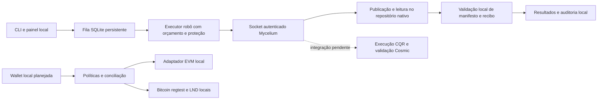

# Mycelium Next: operação local, robôs e wallet própria

Data: 2026-10-05. Escopo: nova base separada, reaproveitando o backend Mycelium. O objetivo é dispensar acompanhamento humano rotineiro, com interface simples e políticas verificáveis. Provisionamento físico, recuperação de chaves e decisões sobre ativos reais continuam exigindo responsabilidade humana. Não existe software que dispense os limites físicos de temperatura; a proposta automatiza essa preocupação.

## Arquitetura

Um repositório, uma configuração e um comando de inicialização. Painel com estado da fila, aceitação, recursos, motivo de pausa e capacidades disponíveis. Toda capacidade incompleta aparece como planejada. A fila e os comprovantes ficam locais; operações em redes públicas exigem comunicação com essas redes, mesmo quando a aplicação e os nós são hospedados localmente.

## O que aproveitar

| Parte atual | Aproveitamento | Limite a preservar |
|---|---|---|
| Backend Mycelium, libp2p e controle Unix | Transporte, identidade e consulta autenticada | Validar autenticação, prazos e compatibilidade do protocolo |
| Sporebank | Encaminhamento de tarefas existentes | Não duplicar a fila sem definir quem é responsável pela tarefa |
| Cosmic | Validação dos resultados e comprovantes | Aceitação exige evidência da tarefa realizada |
| Isotope e dados LWW assinados | Sincronização e dados autenticados | Não constituem consenso de blockchain |
| EventHorizon | Integração opcional do painel existente | O novo painel não depende dele para iniciar |
| Verificador `base_usdc` | Leitura e conciliação de recibos | Não é wallet nem assinador |
| Leitura BOLT11 | Validação de invoices | Não é nó Lightning nem canal financiado |
| `chain_sim_4x_v3` e créditos internos | Testes claramente identificados | MYC, mUSD e ATP internos não são receita recebida |

Preservar os avisos e as licenças aplicáveis ao código reutilizado. Consultar a [licença atual do Mycelium](../LICENSE). Manter a base antiga durante a migração, sem sobrescrever alterações preexistentes.

## Etapas e critérios de conclusão

### 0. Base executável — implementada como protótipo

`apps/mycelium-next` já contém fila durável, idempotência, executor exclusivo, recuperação de interrupções, tentativas limitadas, painel loopback e auditoria local. Há 30 testes de comportamento. Além da consulta de saúde, `artifact_verify` publica e recupera conteúdo pelo repositório nativo, valida um manifesto limitado e publica um recibo verificável. Guarda CIDs confirmados e impede repetição automática após uma confirmação incerta. Esses testes usam sensores e estado S1-MUPP simulados, além de sockets Unix temporários; não comprovam execução produtiva no backend real. Integrações financeiras ainda não existem.

### 1. Concluir as três prioridades locais existentes

O executor agora exige autorização válida e recente do S1-MUPP existente, além de leituras térmicas válidas. Bloqueia sem consumir tentativas e revalida antes de publicar. Ainda é necessário comprovar a integração com o guardião real e estabelecer orçamento de CPU, memória, simultaneidade e tempo por tarefa. A proteção não controla outros processos. Avaliar sensores do processador e demais componentes relevantes; não assumir que uma única leitura representa toda a máquina.

Executar e validar a classe CQR pelo caminho real de tarefas Mycelium, Sporebank e validação Cosmic, conforme `PRIORIDADES_TRABALHO_PAGO.md`. A classe adicional `artifact_verify` usa publicação e leitura nativas para arquivos explicitamente públicos de até 128 KiB; a verificação de tamanho e SHA-256 e o recibo são locais. Esse protótipo não substitui CQR nem comprova integração com Sporebank e Cosmic.

Registrar duração, aceitação e recursos com unidades e origem. Medir energia somente com fonte válida, delimitação temporal e conversão documentada; custo exige tarifa e consumo medido. Enquanto faltarem, usar valores desconhecidos. Comprovar recuperação de interrupção, rejeição de resultado incorreto, ausência de duplicação e bloqueio térmico. As prioridades de `PRIORIDADES_TRABALHO_PAGO.md` permanecem abertas até essas evidências existirem.

Verificação local de 6 de outubro de 2026: 30 testes passaram em 0,118 s. A inspeção real somente leitura encontrou 95,05 °C em um sensor, ausência de `/tmp/s1-mupp-state.json` e recusa de conexão no socket Mycelium. Nenhuma tarefa produtiva foi disparada. O registro `research/evidence/mycelium-next-20261006T121526Z.json` preserva fontes, unidades e limitações. As três prioridades continuam abertas, e a automação permanece ativa.

### 2. Wallet própria e robô de conciliação

Construir uma interface de wallet com capacidades explícitas: ler, assinar e transmitir. Implementar primeiro leitura local e simulação. Quantias sempre em inteiros na menor unidade; nunca usar ponto flutuante para valores monetários.

Assinador local separado do painel, com armazenamento protegido, backup e restauração testados. Chaves não entram no navegador, logs ou argumentos de processos. Políticas delimitam ativo, destinatário, valor por operação, limite acumulado, taxa e rede. Não ativar movimentação real nesta etapa sem definição explícita desses limites.

Estados de operação: rascunho, assinada, transmitida, confirmada, liquidada ou falha. Um robô reconcilia recibos e recomeça após falhas sem pagar duas vezes. Testar timeout após transmissão, confirmação tardia, mudança de nonce, rejeição e recuperação do armazenamento. Saldo observado e recebimento liquidado são indicadores distintos.

### 3. Chain compatível com stablecoin

Usar cliente EVM existente em rede local de desenvolvimento; evitar inventar um consenso antes de comprovar o produto. Wallet e adaptador precisam identificar chain ID, contrato, decimais, nonce, taxas e recibos. Taxas no ativo nativo são contabilizadas separadamente do token.

Um token ERC-20 de teste permite validar compatibilidade da API. Não é USDC nem stablecoin com lastro. Para um ativo estável resgatável, é preciso especificar emissor, reservas, emissão, resgate e verificação correspondente. Não atribuir equivalência de 1:1 apenas ao nome do token. Referência: [padrões de tokens Ethereum](https://ethereum.org/developers/docs/standards/tokens/).

Aceitação: transferência em devnet confirmada por recibo; rejeição de contrato ou rede errados; recuperação após reinício; reconciliação consistente com saldos. Operação com stablecoin pública fica em etapa separada que exige rede externa e ativo real.

### 4. Lightning local

Adicionar Bitcoin regtest e LND locais, com canais de teste financiados em regtest. Validar invoice, expiração, unidade sat/msat, pagamento único e conciliação após falhas. O parser BOLT11 atual é apenas uma parte. Referência: [primeiros passos com LND](https://docs.lightning.engineering/lightning-network-tools/lnd/first-steps-with-lnd).

Tokens ERC-20 não circulam nativamente como pagamentos Bitcoin Lightning. Taproot Assets é uma integração adicional para ativos, com emissão e componentes próprios; não fornece lastro por si só. Estudar sua necessidade depois do fluxo Bitcoin regtest funcionar, sem prometer compatibilidade automática. Referências: [Taproot Assets](https://docs.lightning.engineering/lightning-network-tools/taproot-assets) e [edge nodes](https://docs.lightning.engineering/the-lightning-network/taproot-assets/edge-nodes).

### 5. Robôs e escala por evidência

Começar com um executor e fila limitada. Robôs podem encaminhar tarefas, validar, reconciliar e observar falhas. Aumentar simultaneidade apenas depois de medir trabalho aceito por unidade de tempo, capacidade durável, recursos e estabilidade térmica. Alta escala depende do hardware e da demanda útil, não do número de bots.

Robôs devem aumentar utilidade, disponibilidade e confiabilidade. Não projetar compra e venda entre contas próprias para volume fictício, pump ou ordens enganosas para valorizar preço. O escopo atual não inicia crescimento ou reinvestimento automático.

## Evidências exigidas

| Entrega | Evidência mínima | Condição que impede avançar |
|---|---|---|
| Executor protegido | Sensores ausentes, antigos e quentes bloqueiam sem gastar tentativas; retomada controlada | Sensor desconhecido, hardware quente ou controle não integrado |
| Tarefa produtiva | Resultado validado pelo caminho real Mycelium; duração e recursos registrados | Só teste de saúde ou execução fora da infraestrutura |
| Wallet | Backup/restauração e deduplicação de operações testados em ambiente local | Perda de chave, duplicação ou rede/ativo indefinidos |
| EVM | Recibos de devnet e valores inteiros corretos | Confundir token de teste com stablecoin resgatável |
| Lightning | Invoice regtest liquidada uma vez e recuperação após falha | Apenas invoice analisada, sem nó e canal |
| Escala | Vazão aceita e orçamento de recursos medidos sob carga limitada | Aceitação desconhecida, custo presumido ou pressão térmica |

O diário de hashes é auditoria local, não chain de consenso. Sem checkpoint independente, não detecta remoção do final ou reescrita completa. Separar no painel: testes simulados, execução local real, devnet e recebimentos reais liquidados.

## Ordem de desenvolvimento

Base e testes → controle S1-MUPP e tarefa útil → métricas completas → wallet e conciliação → EVM devnet → Lightning regtest → avaliação de escala. Cada etapa termina por critérios observáveis. Não há prazo de retorno financeiro estimável sem demanda, recebimento comprovado e custos medidos.
